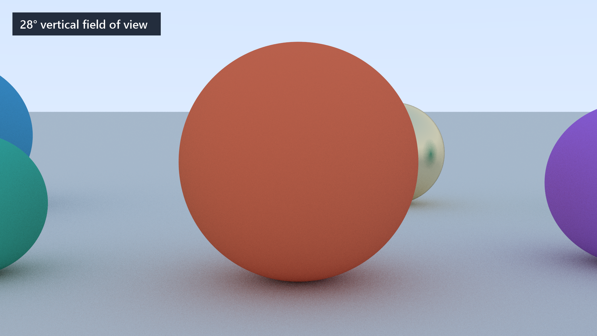
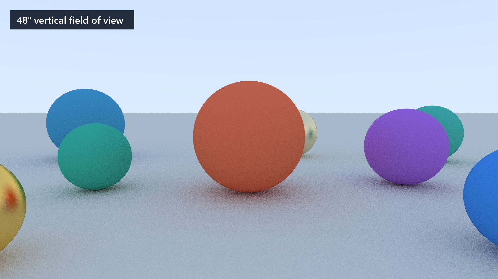
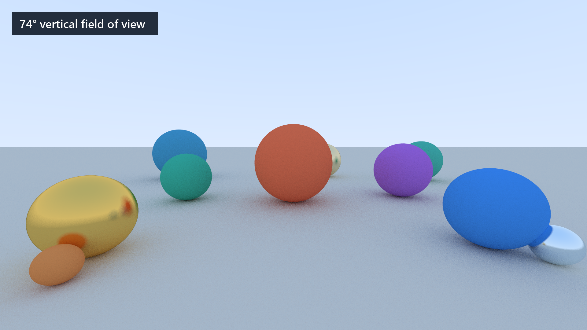

# Pathtracer

A C++ path tracer. Work in progress.







## Install dependencies

Requires a C++23 compiler, Meson, Ninja, and pkg-config. On Ubuntu/Debian:

```sh
sudo apt update
sudo apt install build-essential meson ninja-build pkg-config
```

Meson downloads GoogleTest during setup if it is not already installed, so the
first setup may require internet access.

## Create a local scene

The build requires `app/main.cpp`, which is intentionally ignored by Git. If you
do not already have one, create `app/` and save this example as `app/main.cpp`:

```cpp
#include "pathtracer/geometry/sphere.hpp"
#include "pathtracer/renderer.hpp"

#include <fstream>
#include <memory>

using namespace pathtracer;

int main() {
    Image image{400, 225};
    Camera camera{image};
    camera.initialize();

    Scene scene;
    scene.objects.emplace_back(
        std::make_unique<Sphere>(Vec3{0, 0, -3}, 1.0f),
        Diffuse{Color{0.7f, 0.3f, 0.3f}});

    Renderer renderer{scene, camera};
    renderer.render();

    std::ofstream output{"image.ppm"};
    image.write_ppm(output);
    return output ? 0 : 1;
}
```

## Build and run

From the repository root:

```sh
meson setup build
meson compile -C build
./build/pathtracer
```

The default build enables release optimizations. The example writes `image.ppm`
to the current directory. You can also use `make build` and `make run`.

To install the executable system-wide after building:

```sh
sudo meson install -C build
```
